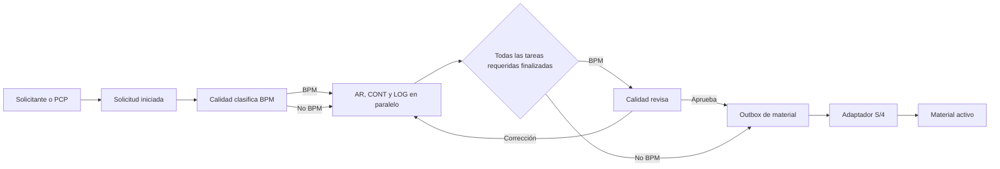

# Arquitectura propuesta

## Objetivo

Gestionar en paralelo la preparación de datos maestros de materiales sin tocar
MARA, MARC, MBEW, MVKE ni otras tablas estándar hasta que el flujo esté listo.
La solución usa RAP para exponer el monitor, las tareas y la configuración a
Fiori Elements o a una aplicación SAPUI5 freestyle.

## Decisión de concurrencia

Una única raíz RAP por solicitud haría que el bloqueo pesimista o el borrador
afectara a todas las áreas. Por ello se separan dos agregados:

1. **Solicitud**: cabecera y estado global; es el monitor/orquestador.
2. **Tarea de área**: raíz transaccional identificada por solicitud y área.
   Cada tarea tiene su propio ETag y sus valores de campo son hijos.

Contabilidad puede actualizar `CONT` mientras Logística actualiza `LOG`, porque
son instancias raíz diferentes. Dos usuarios que editen la misma tarea reciben
control optimista por ETag. La tabla de valores conserva una fila por
`solicitud + área + campo`, lo que permite además auditoría fina.

No se recomienda usar RAP Draft en las tareas concurrentes: el borrador genera
una reserva funcional más larga de la necesaria. `Guardar progreso` persiste
directamente en las tablas Z, con ETag y estado `EN_PROCESO`.

## Componentes

| Componente | Responsabilidad |
| --- | --- |
| `ZDM_SOL_CAB` | Cabecera, operación, material, centro, tipo y estado global |
| `ZDM_SOL_AREA` | Estado y tiempos de cada área; raíz de concurrencia |
| `ZDM_SOL_CAMPO` | Valores dinámicos por campo y área |
| `ZDM_CFG_CAMPO` | Matriz tipo material/centro/operación/área/campo |
| `ZDM_SOL_LOG` | Auditoría de cambios y acciones |
| `ZDM_SOL_SALIDA` | Outbox para integración asíncrona e idempotente |
| `ZI_DM_SOLICITUD` | BO de monitor y acciones de orquestación |
| `ZI_DM_TAREA_AREA` | BO editable concurrente por área |
| `ZI_DM_CFG_CAMPO` | BO de configuración administrable |
| `ZIF_DM_MATERIAL` | Puerto de integración con el maestro de materiales |

## Flujo

El Excel amplía las áreas según centro y tipo de material: SOLIC, COM, PCP, AR,
CONT, LOG, AS y CC. La configuración determina cuáles se crean y cuáles quedan
en gris/no requeridas.

## Estados

- Solicitud: `BORRADOR`, `PEND_CLASIF`, `EN_PROCESO`, `PEND_REVISION`,
  `PEND_INTEGRACION`, `ACTIVA`, `CORRECCION`, `ERROR_INTEGRACION`, `CANCELADA`.
- Área: `NO_REQUERIDA` (gris), `PENDIENTE` (rojo), `EN_PROCESO` (amarillo),
  `FINALIZADA` (verde), `CORRECCION` (rojo).
- Salida: `PENDIENTE`, `PROCESANDO`, `PROCESADA`, `ERROR`.

Las transiciones se validan en dominio; el cliente no puede cambiar estados
directamente.

## Matriz dinámica

La clave de `ZDM_CFG_CAMPO` incluye sociedad, centro, tipo de material,
operación, área y nombre técnico. Admite prioridad por especificidad y los
estados `OCULTO`, `LECTURA`, `OPCIONAL` y `OBLIGATORIO`.

Para UI completamente dinámica se recomienda SAPUI5 freestyle consumiendo la
colección `Campos`. Fiori Elements sirve para el monitor y configuración, pero
no crea controles de distintos tipos a partir de filas en tiempo de ejecución.
El backend siempre vuelve a validar obligatoriedad, formato, pertenencia al
área y autorización; ocultar un campo en UI no es un control de seguridad.

## Acciones RAP

- Solicitud: `ClasificarBpm`, `SolicitarCorreccion`, `AprobarYActivar`,
  `ReintentarIntegracion`, `Cancelar`.
- Tarea: `GuardarProgreso` y `FinalizarTarea`.

`FinalizarTarea` comprueba todos los campos obligatorios configurados. La última
tarea requerida provoca una transición atómica: para no BPM crea la fila de
outbox; para BPM deja la solicitud pendiente de revisión.

## Integración e idempotencia

La creación definitiva se ejecuta fuera de la interacción HTTP. Una fila de
outbox usa `ID_SOLICITUD` como clave idempotente. Un job Application Job reclama
filas pendientes con bloqueo corto, llama a `ZIF_DM_MATERIAL` y almacena el
número de material o el error normalizado.

- S/4HANA privado/on-prem: implementación clásica que encapsule
  `BAPI_MATERIAL_SAVEDATA`, `BAPI_TRANSACTION_COMMIT` y mensajes BAPI.
- SAP BTP ABAP Environment: implementación cloud mediante API liberada de
  Product/Material Master hacia S/4; no se permite invocar una BAPI no liberada.

Nunca se actualizan tablas estándar directamente.

## Autorización

Los roles del documento se traducen a catálogos/roles empresariales y a un
objeto de autorización `Z_DM_AREA` con actividad, sociedad, centro y área.
La DCL restringe lectura; las validaciones de comportamiento restringen
modificación y acciones.

- `Z_DM_ACCESO_SOLICITANTE`
- `Z_DM_ACCESO_REGULATORIO`
- `Z_DM_ACCESO_CONTABILIDAD`
- `Z_DM_ACCESO_LOGISTICA`
- `Z_DM_ACCESO_PCP`
- `Z_DM_ACCESO_CALIDAD`

## Alertas y KPI

Un Application Job busca tareas pendientes o en proceso por encima del SLA y
publica correo mediante el servicio liberado disponible en el sistema. El KPI
de fase paralela es `máximo(fin_area) - inicio_fase`, no la suma de duraciones.
El área cuello de botella es la que tiene el mayor instante de finalización.

## Escalabilidad

- Índices secundarios por estado/fecha, área/estado y solicitud/área.
- Lectura paginada del monitor; los valores se cargan bajo demanda.
- Sin commits dentro de loops ni llamadas remotas en la LUW RAP.
- Outbox con reintentos limitados, próximo intento y registro del último error.
- Auditoría append-only, con enmascaramiento de valores sensibles si aplica.

